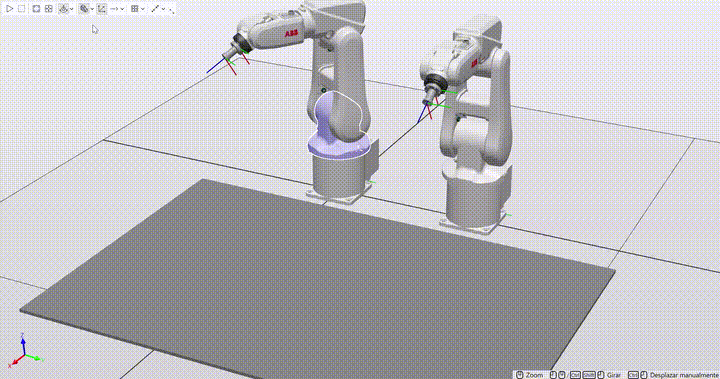
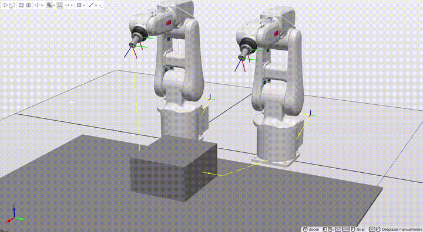
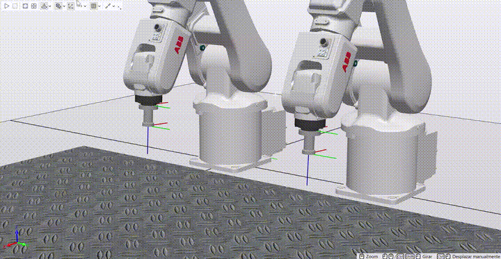

# ABB RobotStudio: Cooperative Dual-Robot Cell (IRB 120) 🤖🤝🤖

## 📌 Overview

This repository contains the simulation and RAPID programming of a **synchronized dual-robot industrial workstation** in **ABB RobotStudio**. The cell features two **ABB IRB 120** manipulators spaced 500 mm apart, each managed by its own independent virtual IRC5 controller (`IRB120_izq` and `IRB120_der`), operating over a shared work surface.

To replicate the physical laboratory setup, a custom **vacuum suction cup tool** was CAD-modeled from scratch in **Autodesk Fusion 360**, imported into RobotStudio, and configured with a local coordinate system and Tool Center Point (TCP) at the contact tip.

The project implements **three progressive multi-robot behaviors** showcasing inter-controller I/O handshaking, sensor-driven linear search (`SearchL`), collaborative payload lifting, and algorithmic tower assembly.

## 🚀 Implemented Cooperative Behaviors

### 1. Synchronized Mirror Trajectory (Behavior 1)

  

* **Objective:** Execute a geometric trajectory simultaneously with both robots maintaining relative spatial synchronization.

* **Implementation:**

  * Target waypoints were generated along the upper vertices of a reference tetrahedron (with the Z-axis inverted by -1 to align with the tool's TCP) and cloned/shifted to the second robot's work object (`wobj`).

  * Both manipulators first move to their respective `Home` positions.

  * **I/O Handshake:** Using cross-connected digital signals (`Output_signal` -> `Input_signal`, and `Ready`), both controllers pause execution via the `WaitDI` instruction until mutual readiness is confirmed, launching the trajectory in unison.

### 2. Collaborative Box Lifting with `SearchL` (Behavior 2)

  

* **Objective:** Approach a shared central box from opposite sides, detect its exact surface contact point using laser sensors, and perform a synchronized dual-arm lift.

* **Smart Components:**

  * Equipped both TCPs with Z-axis linear sensors (`LineSensor_izq`, `LineSensor_der`) calibrated to a 2 mm detection range (5 mm beam length).

  * Integrated `Attacher` and `Detacher` physics components controlled exclusively by the master robot (`IRB120_izq`) to prevent simulation physics conflicts.

* **RAPID Logic:**

  * Both robots move to a lateral approach waypoint and execute a slow Cartesian linear search (`SearchL \Stop`) until the sensor triggers, storing the exact contact pose in `p_Contacto_Real`:

    MoveJ Target_10, v1000, fine, Ventosa_izq\WObj:=wobj2_izq;
    SearchL \Stop, Line_sensor, p_Contacto_Real, Target_10_2, v50, Ventosa_izq\WObj:=wobj2_izq;

  * Once both controllers confirm contact via Digital I/O, the attachment is triggered, and both robots execute identical relative Cartesian offset movements (`Offs`) with matched velocities and zone tolerances to lift, translate, and release the box without kinematic tearing.

### 3. Alternating "Jenga" Tower Assembly (Behavior 3)

  

* **Objective:** Cooperatively build a multi-level Jenga tower (3 blocks per layer, alternating layer orientation by 90 degrees) by taking turns picking blocks from individual feeder arrays.

* **Station Setup:**

  * Modeled Jenga blocks (30 x 20 x 5 mm) arranged in two 5-piece feeder rows (one per robot).

  * Configured `SimulationEvents` linked to `Source` components to dynamically respawn the blocks at their exact initial coordinates upon pressing Play.

* **Algorithmic Placement & Turn Logic:**

  * Pickup waypoints are stored in a RAPID target array.

  * Robots alternate turns using I/O handshaking: while Robot A approaches, searches (`SearchL`), grasps, and places a block, Robot B waits at `Home` for the end-of-turn signal.

  * **Layer & Pose Calculation:** Given the total count of placed pieces (`num_pieza`), the exact placement coordinates and rotation are computed dynamically in RAPID:

    * **Layer (Piso):** `num_pieza DIV 3` (integer division)

    * **Slot (Posición):** `num_pieza MOD 3` (remainder)

    * **Orientation:** Even layers maintain the base orientation (0 deg), while odd layers rotate the TCP by 90 deg prior to placement.

## 🔌 Inter-Controller & Smart Component I/O Mapping

| Signal Name | Controller / Source | Type | Function | 
| ----- | ----- | ----- | ----- | 
| `Output_signal` / `Ready` | `IRB120_izq` / `IRB120_der` | `DO` | Cross-controller synchronization handshake signals | 
| `Input_signal` | Both Controllers | `DI` | Receives readiness/turn completion from partner robot | 
| `Line_sensor` (`Sensor_izq`/`der`) | Smart Component -> Robot | `DI` | Triggers stop interrupt during `SearchL` upon surface contact | 
| `do_attach` / `do_detach` | `IRB120_izq` -> Smart Comp. | `DO` | Actuates vacuum grasping and release physics | 
| `Start_sim` / `Start_sim_2` | Simulation Events / Robot | `DO` | Triggers `Source` cloners to spawn initial workpieces | 
