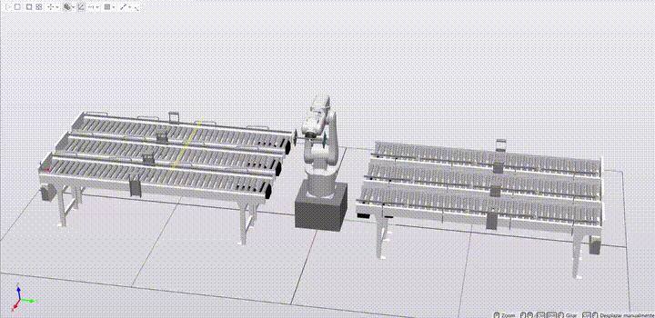

# ABB RobotStudio: Automated Sorting & Dual-TCP Pick & Place Cell 🏭🤖

  
  
  
  

  
  

## 📌 Overview

This repository contains the design, modeling, and programming of an automated industrial sorting station in **ABB RobotStudio** featuring an **ABB IRB 120** manipulator and an **IRC5** virtual controller. 

The cell consists of 3 input conveyors and 3 output conveyors. Boxes of three different heights are spawned randomly across the input lanes. Using laser line sensors and Smart Components, the system identifies the incoming box dimensions and lane, selects the appropriate vacuum gripper from a custom **Dual-TCP end-effector**, and sorts the package onto its designated output conveyor.

## ⚙️ Key Features & Architecture

### 1. Custom Dual-TCP End-Effector Modeling
* Modeled from scratch using RobotStudio's geometry creator.
* Consists of a central mounting bar linking two distinct vacuum grippers ($80 \times 80 \times 10\text{ mm}$ bases): one equipped with **3 suction cups** and the other with **4 suction cups**.
* Configured with **2 Tool Center Points (TCPs)** offset along the $Z$-axis to match the exact contact plane of the suction cones.

### 2. Station Layout & Box Specifications
* **Manipulator:** ABB IRB 120 elevated on a $300 \times 300 \times 200\text{ mm}$ pedestal to optimize workspace reachability across all 6 conveyors (scaled to 50% of their library size, spaced $300\text{ mm}$ apart along the $X$-axis).
* **Workpieces (Boxes):**
  * **Small Box (Type 1):** $100 \times 100 \times 50\text{ mm}$ $\rightarrow$ Routed to Output Conveyor 4.
  * **Medium Box (Type 2):** $100 \times 100 \times 80\text{ mm}$ $\rightarrow$ Routed to Output Conveyor 5.
  * **Large Box (Type 3):** $100 \times 100 \times 100\text{ mm}$ $\rightarrow$ Routed to Output Conveyor 6.

### 3. Smart Components & Station Logic
* **Random Spawning & Queuing:** Uses random number generators (bounded between $0.5$ and $3.49$) sent via Analog Signals (`Rand_Caja`, `Rand_Cinta`) to RAPID, which triggers 9 `Source` cloners connected to a central `Queue`.
* **Conveyor Physics:** `LinearMover` components translate boxes $1350\text{ mm}$ along the $X$-axis over $3\text{ seconds}$. Output conveyors terminate in a `Sink` component to despawn sorted boxes.
* **Sensing Array:** 
  * 2 height discrimination laser sensors (`LineSensor_Med`, `LineSensor_Alto`) to classify box dimensions on the fly.
  * 3 end-of-belt sensors (`Cinta_1`, `Cinta_2`, `Cinta_3`) to halt the conveyor and trigger the pick routine.
* **Dynamic Gripper Physics:** `Attacher` and `Detacher` components synchronized with robot Digital Outputs (`TCP_InPos`, `TCP_End`) and Digital Inputs (`Attached_Done`).

### 4. RAPID Programming & Trajectory Control
* **Interactive Initialization:** Prompts the operator via the **Virtual FlexPendant** to input the desired batch stock for Small, Medium, and Large boxes before moving to the `Home` position.
* **Motion Planning:** Combines high-speed joint movements (`MoveJ`) for approach waypoints ($30\text{ mm}$ $Z$-offset) with reduced-speed linear Cartesian movements (`MoveL`) for picking and placing.
* **Synchronization:** Enforces `fine` stop point tolerances prior to triggering I/O pulses (`PulseDO TCP_InPos`) and waits for physical confirmation (`WaitDI Attached_Done, 1`) to prevent premature grasping or simulation faults.

## 🔌 I/O Signal Mapping (IRC5 <-> Smart Components)

| Signal Name | Type | Description |
| :--- | :---: | :--- |
| `Rand_Caja` / `Rand_Cinta` | `AI` | Analog values for random box type and conveyor selection |
| `Generar_Rand_Caja` / `Cinta` | `DO` | Triggers random number generation in Smart Component |
| `Opt_peq_1..3` / `med_1..3` / `grande_1..3` | `DO` | Clones the specific box type on Conveyor 1, 2, or 3 |
| `S_Alto` / `S_Medio` | `DI` | Laser sensors detecting box height along the input lanes |
| `S_C1` / `S_C2` / `S_C3` | `DI` | End-of-conveyor sensors indicating box ready for pick |
| `CB_InPos` | `DI` | Confirms box is stopped and ready at pick position |
| `TCP_InPos` / `TCP_End` | `DO` | Triggers `Attacher` (grasp) and `Detacher` (release) |
| `Attached_Done` | `DI` | Feedback signal confirming object attachment to TCP |
